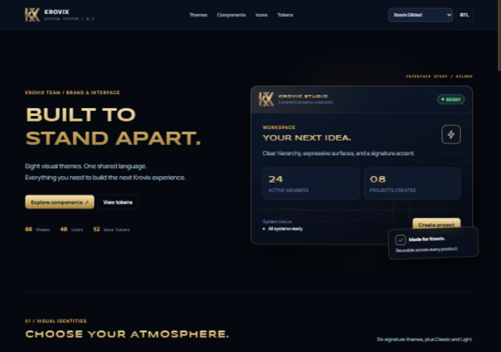

# Krovix Design System

The shared visual language for Krovix Team products, extracted from [Event Studio](https://github.com/vzjRR/battle-royal-five-m). This is a standalone HTML/CSS/JavaScript package with no runtime dependencies and no FiveM, Lua, RPC, database or game logic.



## Included

- **8 themes:** Gilded, Sapphire, Obsidian, Emerald, Crimson, Arctic, Classic and Light.
- **52 foundational tokens** for typography, surfaces, accents, status, radii, shadows and artwork; each theme's inherited values are exported as JSON.
- **40 line icons**, two language flags, bundled font files with their OFL notice, original Krovix marks and three background artworks.
- Scoped buttons, chips, badges, forms, cards, tables, navigation, panels, progress and metrics; optional HUD, results, device and Event Studio patterns.
- Native DOM component helpers, isolated per-container theme switching, derived color overrides and an interactive visual catalog.

## Preview

Requires Node.js 20 or newer. No dependency installation or build step is needed.

```sh
git clone https://github.com/vzjRR/krovix-design-system.git
cd krovix-design-system
npm run preview
```

Open **http://127.0.0.1:8766**. Switch themes, inspect tokens, search icons, try the accent override and toggle RTL. Direct links support `?theme=krovix-obsidian&dir=rtl`.

## Use in a product

Install from GitHub; this package is not published to npm:

```sh
npm install github:vzjRR/krovix-design-system
```

With a bundler:

```js
import '@krovix/design-system/styles.css';
import { applyTheme, button } from '@krovix/design-system';

const app = document.querySelector('#app');
applyTheme('krovix-gilded', { root: app });
app.append(button('Continue', { variant: 'primary', onClick: () => console.log('Continue') }));
```

If your bundler relocates JavaScript without copying the package's artwork, supply `baseUrl` pointing to the hosted package root. CSS font URLs are relative to their bundled stylesheet. See [Integration](docs/integration.md) for native modules, static HTML, React and FiveM examples.

All control and panel styles are scoped beneath `.krovix`. Tokens live on that container. No page-wide transparent background, fixed viewport, hidden overflow or disabled text selection is imposed. Optional overlay patterns intentionally use fixed positioning when their classes are present. A CSS-only page can set `class="krovix" data-theme="krovix-gilded" data-shape="round" data-title="metal"` on an ancestor.

## Structure

| Path | Purpose |
| --- | --- |
| `src/tokens/base.css` | Base CSS custom properties |
| `src/themes/` | Theme values and portable registry |
| `tokens/tokens.json` | Base and inherited per-theme token values; aliases retained |
| `src/styles/index.css` | Fonts, all themes, shared components, keyboard and reduced-motion support |
| `src/styles/overlays.css` | Optional HUD, scoreboard, result and toast patterns |
| `src/styles/event-studio.css` | Optional complete Event Studio and device panel patterns |
| `src/index.js` | Native module API |
| `assets/` | Fonts, marks and artwork |
| `preview/` | Interactive visual reference |
| `SOURCE.json` | Original commit, file paths and SHA-256 provenance |

## Validation

```sh
npm test
npm run check
npm pack --dry-run
```

CI performs the same checks. The tests cover theme switching, override cleanup, container isolation, invalid inputs and asset paths. The asset check validates registries, token references and local CSS URLs.

With the preview running, open `http://127.0.0.1:8766/tests/browser.html` for nine native-browser integration checks covering DOM safety, accessible controls, isolated CSS and computed theme styling.

## Source and ownership

Extracted from commit [`2ae9ae08f19bbf833e7e1e8153a14d510fb7987e`](https://github.com/vzjRR/battle-royal-five-m/tree/2ae9ae08f19bbf833e7e1e8153a14d510fb7987e) on 4 October 2026. Original token values, icon geometry, font binaries and brand artwork are preserved. See [Extraction notes](docs/extraction.md) for transformations and the source file mapping.

Copyright © 2026 Krovix Team. Public visibility does not grant an open-source license to the code or brand assets. This extraction does not relicense the original material. Its existing [draft source notice](notices/EVENT-STUDIO-LICENSE.md) is preserved for provenance, not introduced as a new design-system license. Fonts retain their separate [SIL Open Font License](assets/fonts/OFL.txt).

The original game repository is unchanged. This is an independent snapshot; changes do not synchronize automatically. Integrating it into Event Studio can be a separate change after reviewing this package.
